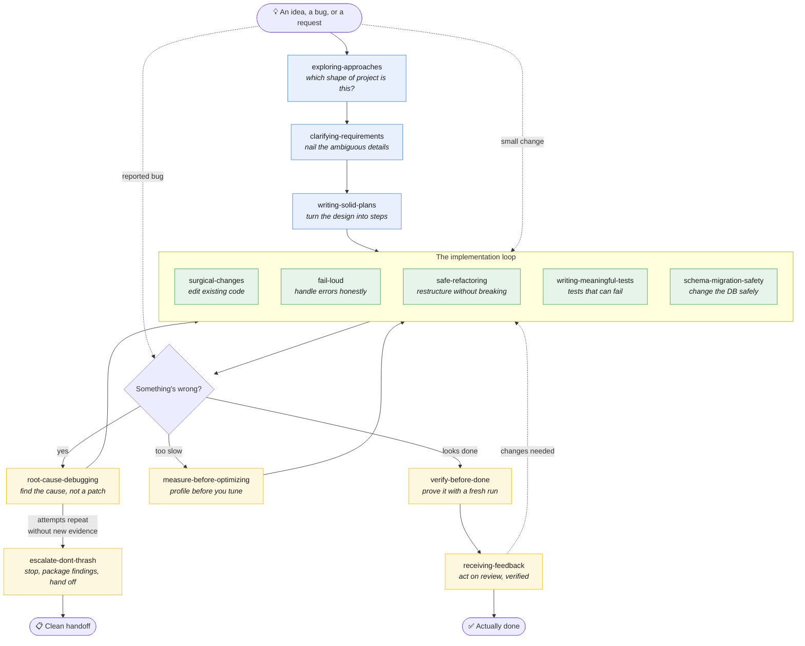

# no-cape

> "No capes!" — Edna Mode

Lean engineering-discipline skills for frontier-class AI models (Claude Fable 5 and beyond) — with a cape mode that enforces the same discipline on the tiers below.

Heavyweight skill frameworks were written for an earlier generation of models — ones that needed Iron Laws repeated five times, rationalization tables, and "you MUST invoke this even at 1% relevance" to stay disciplined. Frontier models don't need the coercion. But buried inside that scaffolding is real knowledge: decision rules, stop conditions, and evidence requirements that no amount of model intelligence replaces.

**no-cape keeps the knowledge and drops the cape.** And for the model tiers that still need one, [cape mode](#cape-mode) puts it back on — same knowledge, coercive delivery.

## The skills

| Skill | Fires when | The kernel |
|-------|-----------|------------|
| [`exploring-approaches`](skills/exploring-approaches/SKILL.md) | Starting a project from a vague idea | A goal names a destination, not a route. Surface the distinct project shapes before refining any one — *even when the user has a preferred approach*. A three-condition brake keeps it from inventing options to look thorough. |
| [`clarifying-requirements`](skills/clarifying-requirements/SKILL.md) | Underspecified new work | Ask only questions whose answers change the design — one at a time, multiple choice preferred. Decompose bundled scope first. Short design before code. |
| [`writing-solid-plans`](skills/writing-solid-plans/SKILL.md) | Planning a multi-step feature or refactor | Plans are for readers with zero context: exact paths, real code, no placeholders ("TBD", "add appropriate error handling"). Self-review coverage and naming consistency before handoff. |
| [`surgical-changes`](skills/surgical-changes/SKILL.md) | Editing existing code | The diff is the product: every line traces back to the request. No drive-by cleanups — report improvements, don't apply them. |
| [`fail-loud`](skills/fail-loud/SKILL.md) | Writing error handling | A swallowed error is a bug with a delay timer. Every fallback is a product decision: "is the system actually correct when this branch executes?" |
| [`safe-refactoring`](skills/safe-refactoring/SKILL.md) | Restructuring working code | Never mix restructure with behavior change. Green before, between, after. Grep beyond the compiler before renaming. |
| [`writing-meaningful-tests`](skills/writing-meaningful-tests/SKILL.md) | Writing or modifying tests | Test behavior, not mocks. No test-only methods in production. Wait for conditions, never sleep. A test you've never seen fail proves nothing. |
| [`measure-before-optimizing`](skills/measure-before-optimizing/SKILL.md) | Performance work | No optimization without a measurement. State the baseline, fix the structural cost, re-measure the same workload. |
| [`schema-migration-safety`](skills/schema-migration-safety/SKILL.md) | Database schema changes | Old code runs against new schema during every deploy. Expand–contract, tested rollbacks, no data backfill inside migrations. |
| [`verify-before-done`](skills/verify-before-done/SKILL.md) | About to claim "done", "fixed", or "passing" | A claim needs a fresh command run in this turn. Lint ≠ build ≠ tests. Subagent "success" reports need a diff check. Tests passing ≠ requirements met. |
| [`receiving-feedback`](skills/receiving-feedback/SKILL.md) | Receiving review comments or corrections | Verify feedback against the codebase before implementing. Clarify every unclear item before acting on any. No performative agreement — the diff is the acknowledgment. |
| [`escalate-dont-thrash`](skills/escalate-dont-thrash/SKILL.md) | Repeated attempts at the same problem failing without new evidence | When attempts stop producing new information, stop producing attempts. Leave the tree no worse than found, write a handoff summary (facts, eliminated hypotheses, failed attempts), recommend escalation. Bounded failure beats confident thrashing. |

Each skill is under 400 words. They state rules once and trust the model to follow them.

## The harness

The skills aren't a pipeline you march through — they're discipline that fires at the moment it's needed. This map shows *where in a project's life* each one waits for you. Most projects touch only a few; a one-line bug fix jumps straight to the debugging loop, while a greenfield service starts at the top.



### Where each skill helps you

**Front of the project — before any code (blue).**
- **`exploring-approaches`** stops you from building the wrong thing fast. When you say "a service that translates English audio," it surfaces the real fork (cloud API vs. self-host vs. SaaS) *before* anyone refines details — and challenges your stated preference if it spots a blind spot like data-residency rules.
- **`clarifying-requirements`** kicks in once the route is chosen but the details are fuzzy. It asks only the questions whose answers change the design, one at a time — no five-question dumps.
- **`writing-solid-plans`** helps when the work spans many steps. It forces a plan a context-less engineer could execute: exact paths, real code, zero "TBD".

**The implementation loop — while writing code (green).**
- **`surgical-changes`** keeps your diff honest in code you didn't just write — every line traces to the request, no drive-by cleanups.
- **`fail-loud`** helps the moment you write a `try/catch` or a fallback, so a swallowed error doesn't become a silent bug with a delay timer.
- **`safe-refactoring`** protects you when you restructure working code — never mixing a rename with a behavior change, staying green throughout.
- **`writing-meaningful-tests`** helps you write tests that actually prove something — testing behavior, not mocks, and never a test you haven't seen fail.
- **`schema-migration-safety`** is your guardrail on database changes, where old code runs against the new schema mid-deploy and a bad migration loses real data.

**Checking the work — before you claim it's done (yellow).**
- **`root-cause-debugging`** helps when something breaks: it stops the guess-and-patch spiral and, after three failed fixes, makes you question the architecture instead of the line.
- **`measure-before-optimizing`** helps when something's slow — it refuses to let you tune without a baseline measurement of the real workload.
- **`verify-before-done`** is the gate before you say "fixed" or "passing" — it demands a fresh command run *this turn*, because lint ≠ build ≠ tests.
- **`receiving-feedback`** helps when a reviewer pushes back — verify each point against the code before implementing, and let the diff be the acknowledgment instead of performative agreement.
- **`escalate-dont-thrash`** is the exit ramp when the loop stops converging: attempts keep failing without producing new evidence. It converts an unbounded failure (an hour of confident thrashing, code worse than before) into a bounded one — a ten-minute handoff summary of verified facts, eliminated hypotheses, and failed attempts, plus an explicit escalation recommendation.

## Install

**As a Claude Code plugin (recommended):**

```
/plugin marketplace add yuchi-chang/no-cape
/plugin install no-cape@no-cape
```

**Manual copy (works with any [agentskills.io](https://agentskills.io)-compatible tool):**

Copy any folder under `skills/` into:

- `~/.claude/skills/` — personal, all projects (Claude Code)
- `<project>/.claude/skills/` — per project

## Skill awareness (the roster hook)

A skill's `description` only helps if the model actually scans the skill list before it starts working — and in long or task-focused sessions, it often doesn't. So no-cape ships a `SessionStart` hook that injects a one-line roster at the top of each session: the skill names paired with *when each applies*. Nothing more.

This is borrowed *mechanism*, not borrowed *coercion*. superpowers injects `<EXTREMELY_IMPORTANT>` text demanding you invoke a skill "if there is even a 1% chance it might apply — you do not have a choice." no-cape's injection says the opposite:

> These are **NOT mandatory**. Load one when its situation actually arises. Use judgment; skip the ones that don't apply.

The roster makes the skills *visible*; the model still decides. It points to the skill — it never repeats the skill's contents (that would just become a shortcut the model takes instead of reading the actual discipline). If you'd rather run without it, the hook degrades silently: delete `hooks/` or remove the `"hooks"` key from `plugin.json` and the skills still work, you just lose the session-open reminder.

### The one required checkpoint

There is a single, deliberate exception to "the model still decides." The roster ends with a required front-of-project checkpoint: before starting a new piece of work, and before writing any code for it, the model must pause once and state its read on the two front-of-project disciplines — `exploring-approaches` and `clarifying-requirements`.

This exists because those two fire *once per project*. The implementation-loop skills recur — miss `fail-loud` on one `try/catch` and the next one comes around. But the front-of-project decisions happen at a single moment; skip that moment and it's gone. Pure opt-in fails precisely there: the model slips past the decision on momentum, without ever weighing it. (That's not hypothetical — it's the exact miss that motivated this checkpoint.)

The checkpoint stays true to the "knowledge over coercion" principle by forcing the **action, not the conclusion**. superpowers forced the conclusion — "1% chance it applies → you MUST invoke." This forces only that the model *pause and say its read out loud*; adopting a skill or judging both unnecessary are equally valid answers. It converts a silent skip into a visible, accountable one — the minimum coercion that closes the gap, scoped to the two skills that can't recover from being missed. Everything else in the roster stays judgment-only.

### Manual override: `/no-cape`

When a skill didn't auto-trigger but you want its discipline applied anyway, the `/no-cape` command is the escape hatch:

- `/no-cape surgical-changes` — load that skill and apply it to the current work (prefixes work too: `/no-cape surgical`)
- `/no-cape` — list the skills and pick one

This keeps the discipline auto-triggering by default, and hands you a manual switch for the times it doesn't. Like the roster, the command only routes to the skill — it never restates the skill's contents.

## Cape mode

> Edna said "no capes" to *supers*. If you're not super yet, you get a cape.

The original no-cape thesis was never "models don't need coercion" — it was "**frontier** models don't." Weaker tiers (Sonnet, Haiku, older Opus) fail differently: they don't lack the discipline knowledge, they miss the *moment* to load it, and they follow short in-context rules far more reliably than judgment calls. Cape mode is the same 13 skills delivered coercively, for exactly those tiers. One knowledge base, two delivery modes.

### What it changes

Three mechanisms, all in `hooks/`:

1. **Directive roster with kernels (`SessionStart`).** Instead of the lean "use judgment" roster, cape mode injects "load the matching skill BEFORE doing the work" — plus the distilled kernel of every skill as always-on rules (a portable mini-CLAUDE.md). The kernels are the floor: even if the model never loads a single skill, the one-line cores are already in context.
2. **Deterministic skill triggering (`UserPromptSubmit`).** The weakest link in any skill system is the trigger — the model has to *notice* the situation. Cape mode scans each prompt for situation keywords (bug/refactor/slow/migration/tests/error-handling, English and 中文) and injects a reminder naming the matching skill. At most two per prompt; misfires cost one line and say so.
3. **Verification gate (`Stop`).** The deterministic version of `verify-before-done`: when the agent tries to end its turn, the project's verify command runs; if it fails, the stop is blocked and the failure output handed back. The model can no longer say "done" past a red build — the gate holds the line, not the model. Blocks once per turn, then yields (endless blocking teaches nothing).

### Mode resolution

First hit wins:

1. `NO_CAPE_MODE` env var — `lean` or `cape`, absolute override.
2. `"mode"` in `<project>/.no-cape.json`.
3. Auto by model id: fable/mythos-class → lean; anything else → cape; model unknown → lean (fails open to the non-coercive mode).

Only `SessionStart` receives the model id, so it resolves once and caches per session under `~/.no-cape/state/`; the other hooks read the cache.

### Per-project config: `.no-cape.json`

```json
{
  "mode": "cape",
  "verify": "npm run lint && npm test"
}
```

Both keys optional. `verify` arms the Stop gate — keep it fast (lint, build, quick tests); without it the gate stays silent. `mode` pins the mode regardless of model.

**Windows latency note:** hooks run through git-bash, and on Windows every external process *and every `$(...)` subshell* is an expensive fork (a naive grep/sed implementation of the prompt scan measured **12.6s** per prompt). The shipped scripts are fork-free — pure bash builtins with `printf -v` out-parameters — and measure **~0.4s** per prompt on a Windows 10 test machine, which is the cmd+bash startup floor. On Linux/macOS the whole thing is negligible. If you touch `hooks/`, preserve this: no external commands, no command substitution in the per-prompt path.

### The honest ceiling

Cape mode narrows the **process-failure** gap: unverified "done", drive-by edits, symptom-patching, silent fallbacks, forgotten discipline. That's most of what makes weaker tiers frustrating day to day — but it is not the whole gap. The **reasoning** gap — multi-file causal chains, architectural taste, judgment under ambiguity — is weights-deep, and no injection closes it. Two consequences:

- Don't expect a caped Sonnet to *be* Fable. Expect it to stop failing in the ways that were never about intelligence.
- When a task hits the reasoning ceiling, the right move is escalation, not more scaffolding — which is why `escalate-dont-thrash` is a first-class skill and its kernel rides along in every cape-mode session: the one discipline that manages the ceiling instead of pretending to remove it.

Pre-task routing ("is this task above my tier?") is deliberately **not** attempted: judging that accurately requires exactly the metacognition weaker tiers lack. Cape mode only detects the *symptoms* after the fact — countable signals like repeated failed attempts — and forces a clean, bounded handoff.

## Design principles

Contributions welcome if they follow the same rules:

1. **Knowledge over coercion.** State the rule and the reason once. No Iron Laws, no rationalization tables, no ALL-CAPS threats. If a rule needs to be repeated five times to hold, the rule is the problem. Making a skill *visible* (the roster hook) is fine; *forcing a conclusion* ("you MUST invoke this") is not. Forcing an *action* the model then judges freely — pause and state your read, as the one required checkpoint does — is the narrow, accountable exception, and only where a decision fires once and can't be recovered. **Cape mode is the sanctioned larger exception**: full coercion, but scoped strictly to model tiers that measurably need it, resolved per session, and never mixed into the lean path. The skills themselves stay written to the lean bar — coercion lives only in the delivery hooks.
2. **Trigger-precise descriptions.** `description` says *when* to fire, never summarizes the workflow (a workflow summary becomes a shortcut the model takes instead of reading the skill).
3. **Under 400 words per skill.** Skills load into context; every token competes with the actual task.
4. **Decision rules and stop conditions, not process theater.** "3 failed fixes → stop" earns its place. "Announce that you are using this skill" does not.
5. **Don't duplicate the harness.** Worktrees, parallel agents, plan execution, and review dispatch are native tooling in modern harnesses — skills shouldn't reimplement them. (Using a harness extension point, like the `SessionStart` hook above, is the opposite of reimplementing one.)

## Credits

Distilled from [obra/superpowers](https://github.com/obra/superpowers) (MIT) by Jesse Vincent — the discipline kernels in these skills trace back to that project. What's removed is the enforcement scaffolding; what remains is rewritten for models that don't need it.

## 繁體中文

這是一套給新世代強模型用的精簡工程紀律 skill。舊框架（如 superpowers）為了讓較弱的模型守紀律，加了大量強制性提示詞；強模型不需要被脅迫，但框架裡的真知識——決策規則、停止條件、證據要求——依然有價值。no-cape 留下知識，拿掉披風。

這 13 個 skill 不是一條要你逐步走完的流水線，而是在開發旅程的各個位置「待命」的紀律——大多數任務只會碰到其中幾個。上方 **The harness** 一節有一張流程圖，標出每個 skill 在專案生命週期的哪個階段幫到你：從零發想（`exploring-approaches`）→ 釐清需求 → 規劃 → 實作循環 → 除錯 → 驗證收尾。一行的 bug 修正可以直接跳到除錯迴圈；從頭打造的新服務則從最上面開始。

安裝方式見上方 Install 一節，或直接把 `skills/` 底下的資料夾複製到 `~/.claude/skills/`。

`description` 寫得再精準，也得模型真的去掃 skill 清單才有用——而在專注於任務的長對話裡，它常常不會。所以 no-cape 內建一個 `SessionStart` hook，在每個 session 開頭注入一份極簡清單：skill 名稱配上「何時適用」，僅此而已。這是借鏡 superpowers 的**機制**，不是借鏡它的**脅迫**：superpowers 注入「即使 1% 相關也 MUST invoke，你沒得選」；no-cape 的注入明說「這些**不是強制**，情境真的出現時再 load，用判斷力、不適用就跳過」。清單只負責讓 skill「被看見」，要不要用仍由模型決定，而且只指路、不複述 skill 內容。不想要的話，刪掉 `hooks/` 或拿掉 `plugin.json` 的 `"hooks"` 欄位即可，skill 照常運作，只是少了開場提醒。

### Cape mode（披風模式）

Edna 的「no capes!」是對超級英雄說的——還不是超級英雄的模型，就給它披風。no-cape 的命題從來不是「模型不需要脅迫」，而是「**前沿模型**不需要」。較弱的模型階層（Sonnet、Haiku、舊版 Opus）敗的方式不一樣：它們不缺紀律知識，缺的是「載入紀律的時機」，而且遵循短規則的能力遠勝於做判斷。Cape mode 就是同一套 13 個 skill 的強制投放版：

1. **指令式開場注入（SessionStart）**——把每個 skill 的核心紀律（kernel）濃縮成一行常駐規則一併注入，等於一份可攜帶的迷你 CLAUDE.md。就算模型從頭到尾沒載入任何 skill，底線規則已經在 context 裡。
2. **確定性觸發（UserPromptSubmit）**——掃描 prompt 中的情境關鍵字（中英文都支援），命中就注入「先載入某某 skill」的提醒。把「何時該用」從模型的判斷變成 harness 的判斷。
3. **驗證閘門（Stop）**——回合想結束時自動跑專案的 verify 指令，失敗就擋下並把錯誤輸出塞回去。模型再也不能在紅燈狀態下說「完成了」。每回合只擋一次，避免無限循環。

模式判定順序：`NO_CAPE_MODE` 環境變數 → 專案 `.no-cape.json` 的 `"mode"` → 依模型自動判斷（fable/mythos 級 → lean，其餘 → cape，偵測不到 → lean）。專案設定範例：`{"mode": "cape", "verify": "npm run lint && npm test"}`。

**誠實的天花板**：cape mode 消除的是「流程型失敗」（沒驗證就說完成、順手亂改、修症狀不修根因）——這是弱模型日常惹人厭的大宗，但不是全部差距。「推理型失敗」（跨多檔案的因果推導、架構品味）是權重層級的，注入什麼都補不了。所以別期待披上披風的 Sonnet 變成 Fable；期待它不再犯那些跟智力無關的錯。碰到推理天花板時，正確動作是升級模型而不是加更多鷹架——這正是 `escalate-dont-thrash` 這個 skill 存在的理由：停止鬼打牆、整理交接摘要、明確建議升級。它管理天花板，而不是假裝天花板不存在。

## License

MIT
